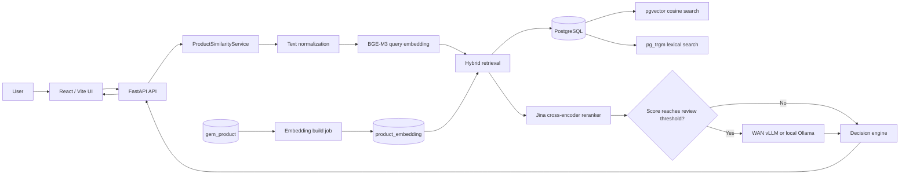

# Sanction Splitting / Duplicate Purchase Checker

This application checks whether a proposed purchase looks like a duplicate of an approved historical purchase. It combines semantic embeddings, lexical matching, cross-encoder reranking, and optional LLM verification, then returns one of three decisions:

- `duplicate` — a sufficiently strong match was found.
- `manual_review` — the evidence is meaningful but not strong enough for an automatic duplicate decision.
- `clear` — no candidate met the configured decision criteria.

The project includes a React web interface, a FastAPI backend, PostgreSQL retrieval through `pgvector` and `pg_trgm`, offline/incremental embedding jobs, and explicitly selected WAN vLLM or local Ollama verification.

> This is a decision-support system. A `clear` result means no match was found under the configured data scope, time window, thresholds, and available models; it is not proof that sanction splitting did not occur.

## Table of contents

- [System overview](#system-overview)
- [Technology stack](#technology-stack)
- [Request flow](#request-flow)
- [Retrieval, reranking, and decision logic](#retrieval-reranking-and-decision-logic)
- [Project structure](#project-structure)sudo ss -ltnp | grep -E '5000|50003|8sudo ss -ltnp | grep -E '5000|50003|8000|8001|8002|11434|5432'000|8001|8002|11434|5432'
- [Database requirements](#database-requirements)
- [Configuration](#configuration)
- [Installation](#installation)
- [Building embeddings](#building-embeddings)
- [Running the application](#running-the-application)
- [API reference](#api-reference)
- [Operations and failure behavior](#operations-and-failure-behavior)
- [Development guidance](#development-guidance)
- [Known limitations and recommended improvements](#known-limitations-and-recommended-improvements)

## System overview



There are two main workloads:

1. **Indexing:** unique product names are normalized, embedded, and stored in `product_embedding` with vector and trigram indexes.
2. **Online checking:** a submitted product is compared with approved purchases from the same central unit and configured date window.

## Technology stack

| Layer | Technology | Purpose |
|---|---|---|
| Frontend | React 18, Vite, Lucide React | Search purchases, submit checks, display evidence and timings |
| API | FastAPI, Pydantic, Uvicorn | Validation, HTTP endpoints, lifecycle management |
| Database | PostgreSQL, psycopg2 | Source purchase data and embedding storage |
| Semantic retrieval | `pgvector`, Sentence Transformers, BAAI/BGE-M3 | Cosine-similarity candidate retrieval |
| Lexical retrieval | PostgreSQL `pg_trgm` | Recovers candidates with similar names or identifiers |
| Reranking | Jina multilingual reranker through `CrossEncoder` | More precise pairwise scoring of the top candidates |
| Final verification | Chat-completions API via WAN vLLM or local Ollama | Classifies product-name similarity using the explicitly selected provider |
| Numerical processing | NumPy, pandas, scikit-learn, PyTorch | Embedding normalization, dates, and model execution |

Default models in the code are:

- Embedding: `BAAI/bge-m3`
- Reranker: `jinaai/jina-reranker-v2-base-multilingual`
- WAN vLLM verifier: `Qwen3-30B-A3B-Instruct` (configurable)
- Local Ollama verifier: `llama3.1:8b`

All are configurable.

## Request flow

For `POST /check_purchase`, the backend performs the following steps:

1. FastAPI validates the product name, central unit, order ID, date, and selected LLM provider.
2. The product name is normalized while preserving useful specifications such as model identifiers, decimal values, percentages, and units.
3. BGE-M3 creates a normalized query embedding.
4. The database searches only eligible historical rows:
   - same `fk_central_unit`;
   - excluding the submitted `order_id`;
   - inside `supply_order_date ± DUPLICATE_WINDOW_DAYS`;
   - `record_status = 'V'`;
   - `approved IS TRUE`;
   - non-empty product name.
5. Two candidate sets are created:
   - nearest vectors above the retrieval threshold;
   - trigram-similar lexical matches.
6. Both sets are combined, deduplicated by bill/order/product, sorted by embedding similarity, and limited to `DUPLICATE_MAX_CANDIDATES`.
7. The first `RERANK_TOP_K` candidates are scored by the cross-encoder and reordered.
8. If the best score reaches the manual-review threshold, up to `LLM_MAX_CANDIDATES` are sent to the requested LLM provider.
9. Thresholds and, when available, the LLM's product-similarity decision produce `duplicate`, `manual_review`, or `clear`.
10. The API returns all candidate evidence plus per-stage timing information.

## Retrieval, reranking, and decision logic

### Candidate retrieval

The current project configuration retains at most 100 combined candidates:

```env
DUPLICATE_MAX_CANDIDATES=100
```

Each vector and lexical branch uses a pool of at least 100 rows. The final combined result is deduplicated and limited to the configured maximum. Vector candidates must have cosine similarity greater than or equal to `DUPLICATE_RETRIEVAL_THRESHOLD`.

### What is reranked?

The reranker does **not** score the full database or all retained candidates. Candidates are first ordered by embedding similarity, and only the top K are reranked:

```env
RERANK_TOP_K=10
```

With the current `.env`, the behavior is therefore:

- retrieve and retain up to 100 candidates;
- rerank candidates 1–10;
- leave candidates 11–100 with their original embedding scores;
- return the reranked top 10 followed by the remaining candidates.

If fewer than 10 candidates are retrieved, all retrieved candidates are reranked. If the reranker cannot be loaded, the service continues with embedding scores and embedding-only thresholds.

### LLM verification

The LLM runs only when the best post-retrieval score reaches the active manual-review threshold. It receives at most `LLM_MAX_CANDIDATES` candidates (currently 10).

The UI requires an explicit provider selection and defaults to `vllm`:

- `vllm`: use only the configured WAN `SEMANTIC_API_URL`.
- `ollama`: use only the local `OLLAMA_API_URL` with `qwen'

There is no provider probing, automatic fallback, or application retry. If the selected provider fails, its error is returned as an unavailable LLM result and the user can select the other provider and run the check again. Score-based decision logic remains available when an LLM result is unavailable.

Only each candidate's rank and product name are sent to the LLM; bill IDs, retrieval scores, and semantic ranks stay local. The model classifies similarity by primary purpose and product type, recognizes synonyms, abbreviations, and renamed equivalents, and treats brand, model, capacity, size, and purchase-quantity differences as insufficient on their own to make products dissimilar. Accessories, spare parts, and consumables are not treated as similar to the main product merely because they mention it. Ambiguous names should produce `false` with low confidence.

For backward compatibility, the response field is still named `same_product`, but it now means **similar under the policy above**. The UI presents it as “Similar” or “Not similar.” The model returns rank, boolean decision, and confidence; explanations are not requested, so the normalized `reason` is normally empty.

### Thresholds

When reranking is active, `RERANK_MATCH_THRESHOLD` and `RERANK_REVIEW_THRESHOLD` are used. Otherwise, the embedding-only `DUPLICATE_MATCH_THRESHOLD` and `DUPLICATE_REVIEW_THRESHOLD` are used.

The review threshold must be less than or equal to the match threshold; invalid configuration stops service initialization.

## Project structure

```text
.
├── frontend/
│   ├── index.html                 # Vite entry document
│   ├── package.json               # Frontend dependencies and commands
│   ├── vite.config.js             # /ui base path and development API proxy
│   └── src/
│       ├── api.js                 # Browser API client and error handling
│       ├── main.jsx               # React application and result views
│       └── styles.css             # Application styling
├── scripts/
│   ├── api_server.py              # FastAPI application and HTTP endpoints
│   ├── build_product_embeddings.py# Full/resumable/incremental index builder
│   ├── config.py                  # .env loading and typed configuration
│   ├── embedding_runtime.py       # Embedding device selection and CPU fallback
│   ├── embedding_scheduler.py     # Daily incremental embedding scheduler
│   ├── product_nlp.py             # Semantic and lexical normalization
│   ├── product_similarity_service.py # Retrieval, reranking, and decisions
│   ├── reranker_runtime.py        # Cross-encoder loader
│   ├── ollama_runtime.py          # Ollama health, model and systemd startup checks
│   └── vllm_category_matcher.py   # Explicit-provider vLLM/Ollama verification
├── requirements.txt               # Python dependencies
├── run_app.sh                     # Production-style local startup script
└── README.md
```

Generated artifacts are stored under `CATEGORIZATION_ARTIFACTS_DIR` (default `categorization_artifacts/`):

```text
categorization_artifacts/
├── embedder/                      # Locally saved embedding model
└── embedding_model.json           # Model, dimension, normalization, and build metadata
```

The metadata prevents the API from silently serving vectors built with an incompatible model or normalization version.

## Database requirements

The configured PostgreSQL user needs permission to read source tables and create/alter the embedding table, extensions, comments, and indexes during a full build.

### Required source columns

The project expects these existing tables and fields:

```text
gem_bill
├── id
├── transaction_id
├── order_id
├── supply_order_date
├── fk_central_unit
├── record_status
└── approved

gem_product
├── fk_gem_bill     -> gem_bill.id
└── product_name
```

### Generated embedding table

The full embedding build creates:

```text
product_embedding
├── id              integer identity
├── product_name    text primary key
├── semantic_text   text not null
├── lexical_text    text not null
└── embedding       vector(model dimension) not null
```

It also creates:

- `vector` and `pg_trgm` PostgreSQL extensions;
- an IVFFlat cosine index on `embedding` (`lists = 100`);
- a GIN trigram index on `lexical_text`;
- source-table indexes supporting bill/product lookups.

Full builds use `product_embedding_staging`, verify it, and swap it into service so the live table remains available during most of the rebuild. A PostgreSQL advisory lock prevents concurrent builders.

## Configuration

Create `.env` in the repository root. Do not commit real credentials.

```env
# Required database connection
TULIP_SOURCE_DB_HOST=localhost
TULIP_SOURCE_DB_PORT=5432
TULIP_SOURCE_DB_NAME=your_database
TULIP_SOURCE_DB_USER=your_user
TULIP_SOURCE_DB_PASSWORD=your_password

# Artifacts and embedding model
CATEGORIZATION_ARTIFACTS_DIR=categorization_artifacts
EMBEDDING_MODEL=BAAI/bge-m3
EMBEDDING_DEVICE=auto

# Retrieval and embedding-only decisions
DUPLICATE_RETRIEVAL_THRESHOLD=0.35
DUPLICATE_REVIEW_THRESHOLD=0.78
DUPLICATE_MATCH_THRESHOLD=0.88
DUPLICATE_WINDOW_DAYS=60
DUPLICATE_MAX_CANDIDATES=100

# Cross-encoder reranking
RERANK_ENABLED=true
RERANK_MODEL=jinaai/jina-reranker-v2-base-multilingual
RERANK_DEVICE=cpu
RERANK_TOP_K=10
RERANK_REVIEW_THRESHOLD=0.70
RERANK_MATCH_THRESHOLD=0.85

# Maximum candidates sent to an LLM
LLM_MAX_CANDIDATES=10

# Permanent WAN vLLM verifier
SEMANTIC_API_URL=https://vllm.example.internal/v1
SEMANTIC_API_KEY=
SEMANTIC_MODEL=Qwen3-30B-A3B-Instruct
SEMANTIC_TIMEOUT_SECONDS=180
SEMANTIC_HEALTH_URL=https://vllm.example.internal/v1/models
SEMANTIC_DISABLE_THINKING=false

# Local Ollama verifier (no API key)
OLLAMA_API_URL=http://127.0.0.1:11434/v1
OLLAMA_HEALTH_URL=http://127.0.0.1:11434/v1/models
OLLAMA_MODEL=llama3.1:8b
OLLAMA_TIMEOUT_SECONDS=180
```

Notes:

- `EMBEDDING_DEVICE=auto` selects CUDA when PyTorch can use it and otherwise selects CPU.
- CUDA embedding initialization and execution fall back to CPU when possible.
- The reranker is loaded from local cache by the API. Download/cache the configured model before offline production startup.
- Set `SEMANTIC_DISABLE_THINKING=true` only when the configured vLLM model and chat template support `chat_template_kwargs.enable_thinking`. It is omitted by default for compatibility.
- `TULIP_SOURCE_DB_SCHEMA` and `DATABASE_URL` may exist in a deployment environment but are not consumed by the current Python code.
- Environment variables already exported by the process take precedence over values in `.env`.

## Installation

### Prerequisites

- Python 3.10 or newer (3.11+ recommended)
- Node.js and npm compatible with the checked-in Vite version
- PostgreSQL with permission to install/use `vector` and `pg_trgm`
- Enough RAM/disk for BGE-M3 and the reranker
- Optional CUDA-compatible GPU and PyTorch installation
- WAN vLLM access and/or a local systemd-managed Ollama installation

### Backend

```bash
python3 -m venv venv
source venv/bin/activate
python -m pip install --upgrade pip
pip install -r requirements.txt
```

Model downloads require network access on the first build. In restricted production environments, prepare the artifacts/model cache before enabling offline mode.

### One-time Ollama setup (Linux)

Use the service installed by Ollama; the application does not create a second daemon:

```bash
sudo systemctl enable --now ollama.service
ollama pull llama3.1:8b
```

The application first checks `OLLAMA_HEALTH_URL`. If unavailable, it inspects
`ollama.service` and runs the non-privileged command `systemctl start ollama.service`.
When the application account lacks permission, startup logs the one-time command above.
It never runs `sudo`, `ollama serve`, or `ollama pull`, and it does not stop Ollama on
application shutdown. Concurrent application workers delegate daemon serialization to
systemd instead of spawning processes.

Verify the daemon and installed model:

```bash
systemctl status ollama.service --no-pager
curl --fail --max-time 2 http://127.0.0.1:11434/v1/models
ollama list
```

### Frontend

```bash
npm --prefix frontend install
```

## Building embeddings

Run a full build after configuring the database and before starting the API for the first time:

```bash
source venv/bin/activate
python -m scripts.build_product_embeddings
```

Available modes:

```bash
# Change the source/model encoding batch size (default: 512)
python -m scripts.build_product_embeddings --batch-size 128

# Resume a compatible interrupted staging build
python -m scripts.build_product_embeddings --resume

# Add product names missing from the live embedding table
python -m scripts.build_product_embeddings --new-only
```

`--resume` and `--new-only` cannot be combined. If CUDA runs out of memory, the builder automatically halves its internal encoding batch size until it succeeds or reaches one item.

### Automatic incremental builds

The API starts a scheduler with its application lifecycle. Between **1:00 PM and 2:00 PM Asia/Kolkata**, it checks for unembedded product names every 15 minutes. When needed, it launches:

```bash
python -m scripts.build_product_embeddings --new-only
```

The readiness endpoint returns `503` while source product names are waiting for this scheduled embedding run.

## Running the application

### Combined production-style startup

```bash
./run_app.sh
```

The script:

1. installs frontend packages when `frontend/node_modules` is absent;
2. builds the frontend into `frontend/dist`;
3. verifies the local Python environment;
4. enables Hugging Face/Transformers offline mode by default;
5. starts Uvicorn on `0.0.0.0:5000` by default;
6. FastAPI startup checks Ollama and asks the existing `ollama.service` to start when needed;
7. attempts to open Google Chrome at `http://localhost:5000/ui`.

Override the listener when needed:

```bash
HOST=127.0.0.1 PORT=8000 ./run_app.sh
```

To intentionally allow model downloads during startup:

```bash
HF_HUB_OFFLINE=0 TRANSFORMERS_OFFLINE=0 ./run_app.sh
```

### Backend development

```bash
source venv/bin/activate
python -m uvicorn scripts.api_server:app --host 0.0.0.0 --port 5000 --reload
```

### Frontend development

In another terminal:

```bash
npm --prefix frontend run dev
```

Vite serves the frontend on port 5173 and proxies API routes to `http://localhost:5000`.

### URLs

- UI: `http://localhost:5000/ui`
- OpenAPI/Swagger: `http://localhost:5000/docs`
- Health: `http://localhost:5000/health`
- Readiness: `http://localhost:5000/ready`

## API reference

### `GET /health`

Process liveness only. It does not verify model or database readiness.

```json
{"status": "ok"}
```

### `GET /ready`

Checks that the service initialized, embedding metadata is compatible, the embedding table is queryable, and every source product name has an embedding.

- `200`: `{"status":"ready"}`
- `503`: database/model initialization failed or embeddings are incomplete

### `GET /existing_purchases`

Searches approved, valid purchases for use in the UI.

Query parameters:

| Name | Required | Description |
|---|---:|---|
| `query` | No | Case-insensitive substring of `product_name` |
| `fk_central_unit` | No | Exact central-unit filter |
| `limit` | No | 1–100; default 25 |

Example:

```bash
curl 'http://localhost:5000/existing_purchases?query=paper&fk_central_unit=1263&limit=25'
```

### `POST /check_purchase`

Request:

```bash
curl -X POST 'http://localhost:5000/check_purchase' \
  -H 'Content-Type: application/json' \
  -d '{
    "product_name": "Unbranded Computer Paper, GSM 70",
    "fk_central_unit": 1263,
    "order_id": "ORD_2024_00999",
    "supply_order_date": "2024-03-15",
    "llm_provider": "vllm"
  }'
```

Use `vllm` or `ollama`. The web UI and API default to `vllm`, disable provider changes while a request is running, and never fall back to the other provider.

Important response fields:

| Field | Meaning |
|---|---|
| `flagged` | `true` for duplicate or manual review |
| `decision` | `duplicate`, `manual_review`, or `clear` |
| `best_similarity_score` | Best active score; may be a reranker or embedding score |
| `reason` | Human-readable decision explanation |
| `conflicting_bills` | Candidate evidence, ranks, scores, and optional LLM decisions |
| `candidate_count` | Number retained after database retrieval/deduplication |
| `thresholds` | Active duplicate, review, and retrieval thresholds |
| `rerank` | Whether reranking is active, model/device/top-K, and load error |
| `llm_same_product` | Provider status, provider latency, and per-candidate similarity decisions; the legacy name is retained for compatibility |
| `timings` | Embedding, database, reranking, LLM, total time, and slowest stage |

For reranked rows, `embedding_similarity_score` preserves the original retrieval score, `rerank_score` contains the cross-encoder score, and `similarity_score` is replaced with the reranker score. Non-reranked rows have `rerank_score: null`.

## Operations and failure behavior

- If database/service initialization fails, `/health` remains live but data endpoints and `/ready` return `503`.
- If the reranker cannot load, it is disabled and its error is exposed in the `rerank` response object.
- If the selected LLM fails, no other provider is called automatically. The response records the selected provider, failure reason, and elapsed milliseconds, and decision processing falls back to scores.
- Database connection and interface failures become generic `503` responses. Other unexpected endpoint errors become generic `500` responses and details stay in server logs.
- The database connection pool supports up to 32 connections.
- Request timing is logged as `purchase_check_timing` for performance investigation.
- The API serves `frontend/dist` when it exists; otherwise it serves the raw `frontend` directory. Build the frontend for a functional production UI.

## Development guidance

When changing the system:

1. Keep semantic and lexical normalization deterministic and versioned.
2. Increment the applicable normalization version in `product_nlp.py` whenever stored normalized text would change, then perform a full embedding rebuild.
3. Calibrate thresholds on labeled procurement examples; do not assume defaults are universally correct.
4. Treat embedding, reranker, and LLM scores as different score spaces.
5. Avoid logging product data, credentials, or full external-provider payloads unless approved by the data owner.
6. Verify both API behavior and UI rendering for `duplicate`, `manual_review`, each explicit provider, provider failure, reranker failure, and empty-result cases.

Suggested smoke checks:

```bash
curl --fail http://localhost:5000/health
curl --fail http://localhost:5000/ready
npm --prefix frontend run build
python -m unittest discover -s tests -v
```

Exercise each provider explicitly (replace the sample IDs with valid local data):

```bash
curl -X POST http://localhost:5000/check_purchase \
  -H 'Content-Type: application/json' \
  -d '{"product_name":"Laser printer","fk_central_unit":1263,"order_id":"TEST-1","supply_order_date":"2024-03-15","llm_provider":"ollama"}'

curl -X POST http://localhost:5000/check_purchase \
  -H 'Content-Type: application/json' \
  -d '{"product_name":"Laser printer","fk_central_unit":1263,"order_id":"TEST-2","supply_order_date":"2024-03-15","llm_provider":"vllm"}'
```

There is currently no automated test suite in the repository. Add unit tests around normalization and decision boundaries, integration tests for SQL retrieval, and API contract tests before making high-risk scoring changes.

## Known limitations and recommended improvements

1. **Mixed score spaces after top-K reranking.** Candidates after `RERANK_TOP_K` retain embedding scores, while active reranker thresholds are applied across the returned list. These values are not directly comparable. Prefer applying decisions only to reranked candidates or maintaining separate score-specific threshold logic.
2. **No authentication or authorization.** The API and UI should be protected before exposure outside a trusted network, especially because purchase history may be sensitive.
3. **No request rate limiting.** Embedding, reranking, and LLM calls are expensive; add per-user limits and bounded concurrency for multi-user deployment.
4. **Synchronous inference inside request handlers.** Heavy model work can block Uvicorn workers. For larger traffic, use a controlled inference worker/service and define timeouts and backpressure.
5. **No migration framework.** Database extensions, tables, and indexes are created by the embedding job. Move schema management to reviewed migrations for repeatable deployments.
6. **Limited automated tests and no CI.** Provider routing is unit tested; add retrieval/ranking evaluations, API integration tests, linting, type checks, dependency scanning, and frontend/backend CI.
7. **Unpinned Python dependencies.** Most packages in `requirements.txt` are unconstrained. Use a lock file or fully pinned, tested dependency set for reproducible deployments.
8. **Readiness requires complete embedding coverage.** A single newly inserted product makes the instance unready until the scheduled run. Consider event-driven incremental indexing or a freshness metric instead of failing all readiness checks.
9. **Local startup assumes Google Chrome.** Make browser launching optional or OS-independent for server deployments.
10. **Threshold governance is manual.** Store model/version/threshold evaluation results together and monitor precision, recall, false positives, latency, and provider-failure rates over time.

For production, the highest-priority improvements are correcting mixed-score decision handling, adding authentication, introducing automated tests, and separating model inference from web request workers.
# sanction_splitting
